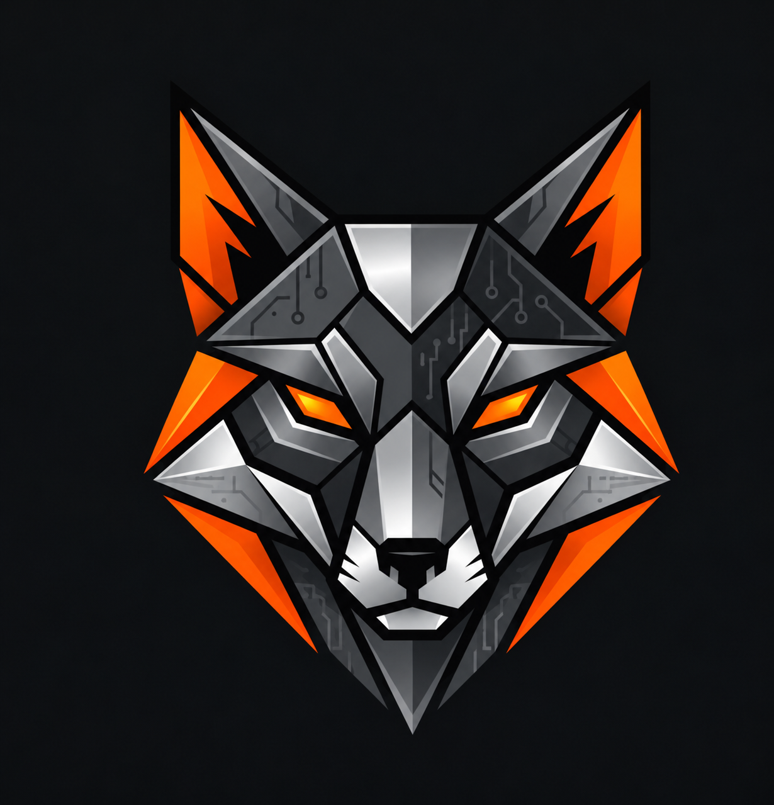
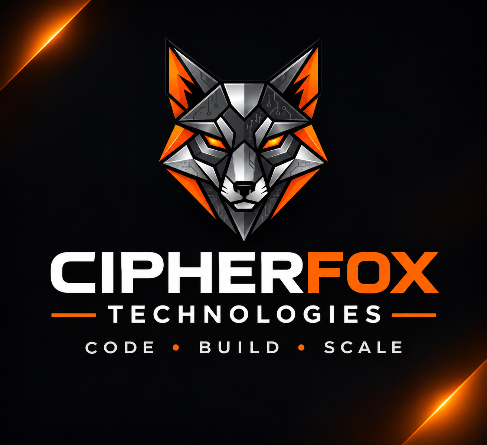

  

  <strong>Building Digital Solutions. Creating Opportunities.</strong>

  Software Development &nbsp; | &nbsp; Technology Solutions &nbsp; | &nbsp; Practical Learning

---

## About CipherFox Technologies

CipherFox Technologies is a software development and technology solutions company focused on building practical digital products and delivering technology-driven solutions.

Our work focuses on software engineering, web application development, backend systems, database engineering and emerging technologies.

Alongside our software development activities, we provide structured internship programmes combining technical learning, practical project development and guided implementation.

## Our Services

| Service | Description |
|---|---|
| Web Development | Modern, responsive websites and web applications |
| Full-Stack Development | End-to-end application development |
| Backend Engineering | APIs, server-side systems and database integration |
| Business Solutions | E-commerce platforms and business management systems |
| AI Application Development | Applications integrating artificial intelligence technologies |

## Internship Programmes

We offer structured programmes designed to help students develop practical technical skills through guided learning and project implementation.

Our programme areas include:

- Full-Stack MERN Development
- AI-Powered Application Development
- Data Analytics & Business Intelligence
- Backend Software Development

## Technology Stack

| Category | Technologies |
|---|---|
| Frontend | HTML, CSS, JavaScript, React |
| Backend | Node.js, Express.js |
| Database | MongoDB, MySQL |
| Programming | C, C++, Java, Python |
| Tools | Git, GitHub, VS Code, Postman |

## Our Approach

- Build practical and maintainable software.
- Focus on hands-on technical learning.
- Encourage collaborative development.
- Apply modern engineering practices.
- Create opportunities through technology.

## Brand Identity

Our visual identity represents technology, innovation and precision through our signature orange, black, silver and white colour palette.

  
Explore our brand assets

 

 

 

## Connect With Us

- **GitHub:** [CipherFox Technologies](https://github.com/CipherFox-Technologies)
- **Website:** [CipherFox Technologies](https://cipherfox-technologies.pages.dev/)

---

  <strong>CIPHERFOX TECHNOLOGIES</strong> 
  CODE. BUILD. SCALE.

